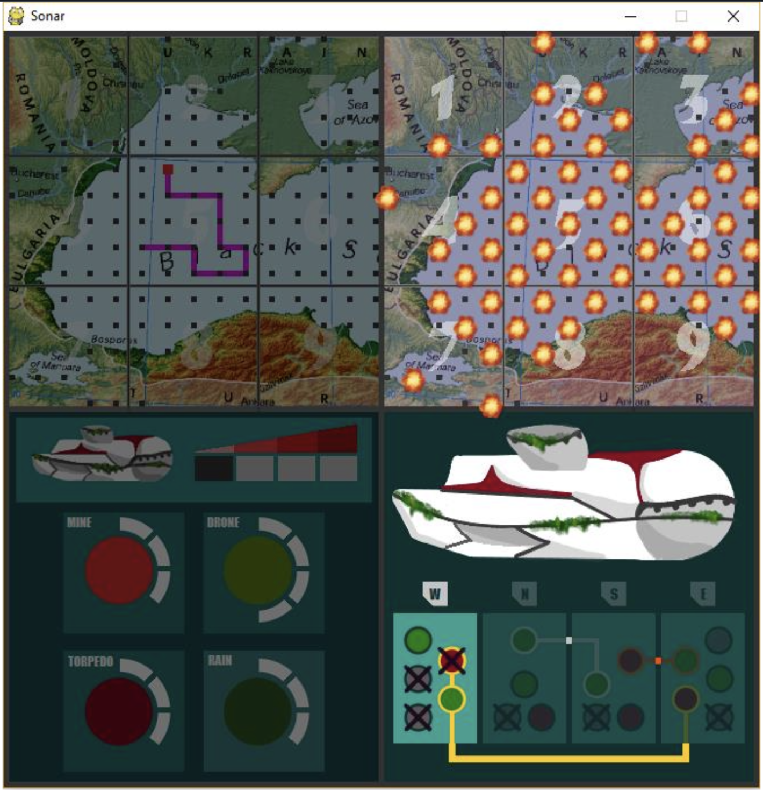

# Capitan Sonar

A two-player, networked computer version of the board game *Captain Sonar*, written in Python with pygame and OpenCV.

This was my **Bachelor's dissertation project**, *"Căpitan Sonar – implementarea pe calculator a unui board game"* ("a computer implementation of a board game"), presented in July 2018 at the Faculty of Computer Science, Alexandru Ioan Cuza University of Iași. The supervisor was Lect. Dr. Cosmin Vârlan. The code is kept mostly as it was then, as an archived project.



## Why a computer version?

*Captain Sonar* (Roberto Fraga and Yohan Lemonnier, 2016) is a team version of *Battleship* in which two submarine crews hunt each other. In the board game, each team has up to four players sitting on one side of a cardboard screen, and they shout orders and track moves with markers. Players often make mistakes in the chaos: a captain announces one move but draws another, or the radio operator mishears an order.

This version keeps the core of the game and uses software to remove those errors:

- Illegal moves (crossing islands or your own path) are impossible.
- The opponent's moves are transmitted and drawn automatically, so the radio operator's information is always accurate.
- The radio operator's trace can't run off the edge of the sheet, and the game shows whether it fits the map.
- One player runs all four crew roles on a single screen, so two people can play over a network.

## How it plays

Each player commands a hidden submarine on a 15×15 grid and tries to sink the opponent first. The game is turn-based: each turn passes through the four crew stations shown on screen.

| Station | What you do |
|---|---|
| **Captain** (top left) | Hover over the map to pick a starting square and click to dive. Then move one square per turn with the arrow keys: Up is North, Down is South, Left is West and Right is East. If you get stuck, you have to resurface, which costs one life and resets your path and systems. |
| **Radio operator** (top right) | You see the opponent's moves but not where they started. Hover over the enemy map to slide their path around: a green background means the path fits there, and pink means it crosses land or leaves the map. |
| **First mate** (bottom left) | After each move, charge one weapon system by clicking it. When a system is fully charged, click it again to launch it. The board game has six systems; this version keeps the four most used. |
| **Engineer** (bottom right) | After each move, break one system in the direction you just moved. Red breakdowns disable the mine and torpedo, and green ones disable the drone and rain. Completing a linked circuit repairs it for free. Breaking every slot in one direction (W/N/S/E), or every radiation (blue) slot, costs a life. |

**Weapon systems**

- **Mine**: place it on a free square next to your submarine. The opponent doesn't see it. It explodes when any submarine enters that square, including your own.
- **Torpedo**: choose a direction with the arrow keys, press the same key up to 4 times to set the distance, then press Enter. It explodes immediately.
- **Drone**: find which of the 9 map sectors the opponent is in.
- **Rain**: a new weapon that isn't in the board game. It bombards every other square of the enemy map in a checkerboard pattern, picking the pattern that avoids your own position. The opponent loses a life if they are on one of the hit squares.

An explosion does 2 damage at its centre and 1 damage on the squares around it. A submarine that loses 4 lives is sunk, and the other player wins.

### Map recognition

Instead of encoding land and water by hand, the game reads them from the map image. Any map with blue water can be used, including real geographic maps such as the Black Sea map in the screenshot. The approach went through several versions:

1. Hard-coded land coordinates for the board game's original map.
2. Reading pixel colours in BGR and treating any pixel with all channels below 100 as land. This works for the board game's flat colours but not for real maps. It's kept in [`image_search_bgr.py`](Sonar/image_search_bgr.py).
3. The final version in [`image_search.py`](Sonar/image_search.py) converts the image to HSV and combines two masks, one for aqua/teal and one for blue/navy, to extract every shade of water. It then denoises the result so that rivers, small lakes and map labels disappear. For each grid point, it scans the surrounding area (adjusted at edges and corners): if more than 50% of the pixels are non-water, the point is marked as land.

### Networking

The game uses a client/server architecture built on [PodSixNet](https://github.com/chr15m/PodSixNet), which is included in the repository. Every message is a Python dictionary whose `"action"` key names a handler on the other side: for example, `{"action": "mine", ...}` calls `Network_mine`. The server queues each new client until a second one connects, pairs them into a game with its own ID, and relays each player's actions to the opponent.

## Running it

> **Note:** the code is from 2018. It targets **Python 2.7** and currently uses Windows-style file paths, so it runs as-is on Windows.

Install the dependencies (Python 2.7):

```bash
pip install pygame numpy opencv-python==4.2.0.32
```

Run everything from inside the `Sonar` folder, because the image paths are relative:

```bash
cd Sonar
python server.py   # starts the server on localhost:1337
python player.py   # first player
python player.py   # second player, in another terminal
```

The game starts once two players have connected. The first player to connect moves first.

**Controls:** use the mouse to pick squares and systems, the arrow keys to move and aim, and Enter to fire a torpedo.

## Repository contents

```
CapitanSonar.pdf      Dissertation paper (in Romanian)
Prezentare.pptx       Dissertation presentation slides (in Romanian)
Sonar/
  player.py           Game client (rendering, game logic, input)
  server.py           Game server (matchmaking and message relay)
  image_search.py     Land/water detection from the map image (HSV)
  image_search_bgr.py Earlier BGR-threshold version of the detection
  graphics/           Sprites and map images
  PodSixNet/          Bundled networking library
```

## Credits and disclaimer

- *Captain Sonar* is a board game by Roberto Fraga and Yohan Lemonnier, published by Matagot. This is an unofficial student project, not affiliated with or endorsed by them.
- [PodSixNet](https://github.com/chr15m/PodSixNet) by Chris McCormick is licensed under the LGPL.
- Al Sweigart's *Making Games with Python and PyGame* (2012) was a reference for the game loop.
